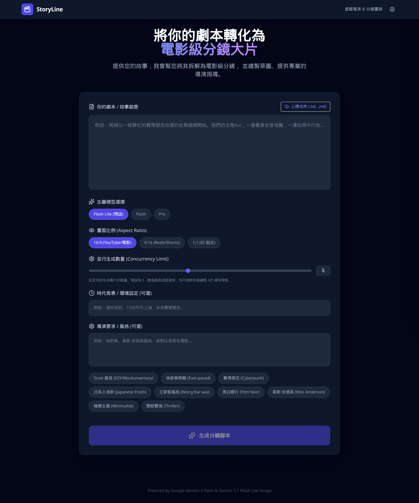

# StoryLine

[English](README.md) | [繁體中文](README.zh-TW.md)

**StoryLine** turns a script into cinematic storyboard cards — shot breakdown, charcoal sketches, and director notes — powered by Google Gemini.



**Live demo:** [https://poirotw66.github.io/storyline/](https://poirotw66.github.io/storyline/)

**Stack:** React 19 · TypeScript · Vite · Tailwind CSS (CDN) · Google Gemini (`@google/genai`) · IndexedDB (projects stay in the browser)

---

## How the AI works

Paste a script (plus optional era and director notes). Gemini returns structured JSON — not free-form prose — so every shot has the same fields the UI expects.

**Script breakdown.** A system prompt casts the model as an experienced storyboard artist. It covers the whole script (no silent omissions), then emits for each shot: scene number, description, dialogue/narration, shot size, camera angle, movement, lighting, director note, and an English `visual_prompt` for image generation.

**Character & era consistency.** Before drawing, the model extracts:

- `historical_context` — period architecture, costume, and props (English)
- `character_definitions` — recurring character appearance and wardrobe (English)

Those strings are written into every shot’s `visual_prompt`, then **injected again** when generating each sketch (`Historical Context` + `Character Definitions` + shot details). A fixed charcoal / noir sketch prefix keeps the visual style consistent across cards.

**After analysis.** You confirm image model, aspect ratio, and concurrency; shots are drawn in parallel (default concurrency 5). You can edit fields, regenerate a shot (version history), save projects in IndexedDB, export a ZIP (markdown + images), or print / save as PDF.

**Style presets** (Mockumentary, Cyberpunk, Wong Kar-wai, etc.) fill the director-requirements field; one preset expands into a longer mockumentary brief.

---

## Local development

Requires Node.js 20+.

```bash
npm install
```

Create `.env.local` (optional):

```
GEMINI_API_KEY=your_key
```

Or skip the file and enter a key in **Settings** in the app (stored in `localStorage` only).

```bash
npm run dev      # development server
npm run build    # output to dist/
npm run preview  # preview production build
```

---

## Deploy

Pushing to `main` runs [`.github/workflows/deploy.yml`](.github/workflows/deploy.yml) and publishes to GitHub Pages (`base: './'` in Vite).

1. **Settings → Pages → Source:** GitHub Actions  
2. Optional: Actions secret `GEMINI_API_KEY` for a default key in the build  
3. Demo URL: [https://poirotw66.github.io/storyline/](https://poirotw66.github.io/storyline/)

> A key baked into the static build is visible to anyone who loads the site. Prefer per-user keys in Settings for a public deploy.

---

## License

[MIT](LICENSE) © 2026 poirotw66
